# QueueCache compared with other RAM disks and RAM caches

Original comparison: October 12–14, 2026. Cache refresh: October 15/16.
The **October 16 new-file drain columns** are a separate three-repetition comparison
with Defender/Search disabled. Other columns retain their original dated results.
Scores are decimal MB/s unless stated otherwise; ranges are minimum–maximum.
[Methods, findings and limitations](COMPARISON_DETAILS.md) explain each measurement.

QueueCache leads large cached reads, and the read-miss fix is merged
([#14](https://github.com/devedse/QueueCache/issues/14)). With the plan-164 drain
default (Eager 2 MiB × 8, read-aware limit 2, asynchronous TRIM), QueueCache beats a
same-window PrimoCache on completed new-file writes including the drain: 292.4
against 261.0 MB/s for one 1 GiB file and 90.7 against 52.5 MB/s for 4,096 64 KiB
files, at matched backend speed
([details](COMPARISON_DETAILS.md#the-new-default-against-primocache-2026-10-21), #15).
The tables below keep their original dates. Power-loss filesystem
safety also remains open ([#13](https://github.com/devedse/QueueCache/issues/13));
both Fast mode and PrimoCache Defer-Write damaged NTFS in historical cuts.

Contents: [RAM disks: CrystalDiskMark](#ram-disks-crystaldiskmark) ·
[RAM caches: CrystalDiskMark](#ram-caches-crystaldiskmark) ·
[RAM disks: complete comparison](#ram-disks-complete-comparison) ·
[RAM caches: complete comparison](#ram-caches-complete-comparison) ·
[Power cuts](#power-cut-while-the-cache-is-writing) ·
[Results per tool](#results-per-tool) · [Not tested](#not-tested) ·
[Setup](#how-this-was-measured) · [Detailed notes](COMPARISON_DETAILS.md)

## RAM disks: CrystalDiskMark

A 4 GiB RAM disk at T:, NTFS. CrystalDiskMark 9.0.3 defaults (1 GiB, 5 passes), the better of two runs, the same way
as the [README](../README.md#performance). Click a screenshot for full size, or a product for its full results.

| Product | CrystalDiskMark | SEQ1M Q8T1 read / write | SEQ1M Q1T1 read / write | RND4K Q32T1 read / write | RND4K Q1T1 read / write |
|---|---|---:|---:|---:|---:|
| [QueueCache 0.4.604.1, RAM disk](comparison/R01-queuecache.md) | <a href="images/comparison/R01-queuecache.png">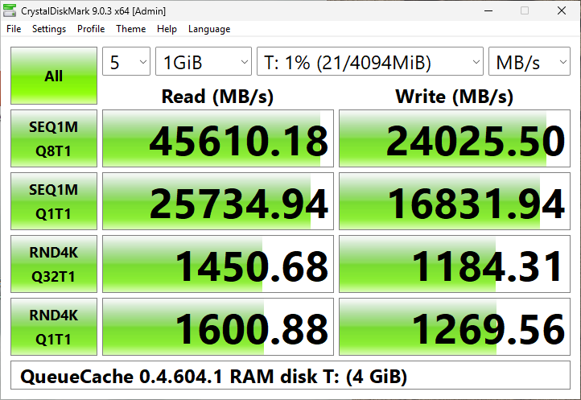</a> | 45,610 / 24,026 | 25,735 / 16,832 | 1,451 / 1,184 | 1,601 / 1,270 |
| [SoftPerfect RAM Disk 26.10, static](comparison/R02-softperfect.md) | <a href="images/comparison/R02-softperfect.png">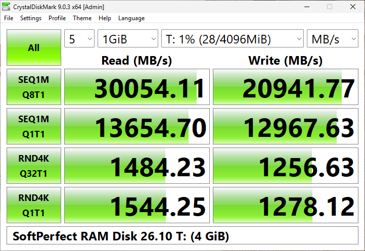</a> | 30,054 / 20,942 | 13,655 / 12,968 | 1,484 / 1,257 | 1,544 / 1,278 |
| [SoftPerfect RAM Disk 26.10, hard-disk emulation](comparison/R02-softperfect-hdd.md) | <a href="images/comparison/R02-softperfect-hdd.png">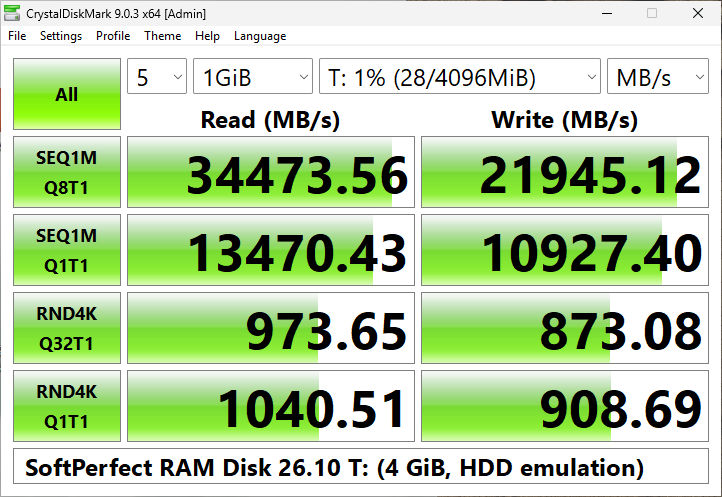</a> | 34,474 / 21,945 | 13,470 / 10,927 | 974 / 873 | 1,041 / 909 |
| [AIM Toolkit 20260420, static](comparison/R03-aim-static.md) | <a href="images/comparison/R03-aim-static.png">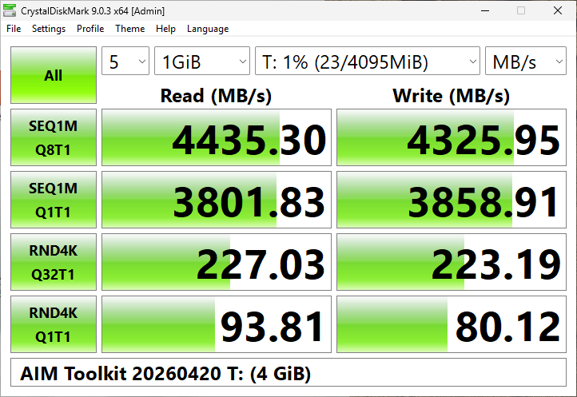</a> | 4,435 / 4,326 | 3,802 / 3,859 | 227 / 223 | 94 / 80 |
| [AIM Toolkit 20260420, dynamic (RamDyn)](comparison/R03-aim-dynamic.md) | <a href="images/comparison/R03-aim-dynamic.png">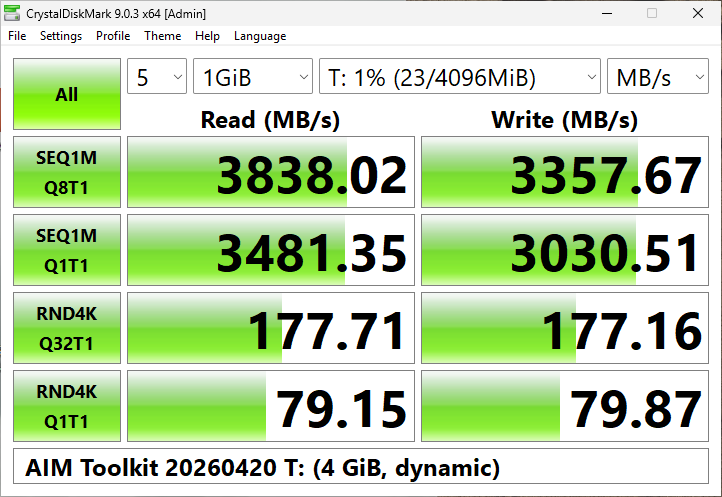</a> | 3,838 / 3,358 | 3,481 / 3,031 | 178 / 177 | 79 / 80 |
| [OSFMount 3.3.1000, logical emulation](comparison/R04-osfmount-logical.md) | <a href="images/comparison/R04-osfmount-logical.png">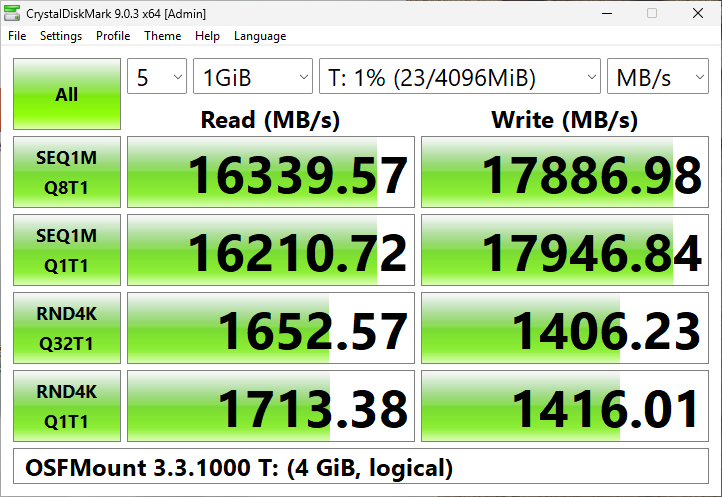</a> | 16,340 / 17,887 | 16,211 / 17,947 | 1,653 / 1,406 | 1,713 / 1,416 |
| [OSFMount 3.3.1000, physical emulation](comparison/R04-osfmount-physical.md) | <a href="images/comparison/R04-osfmount-physical.png">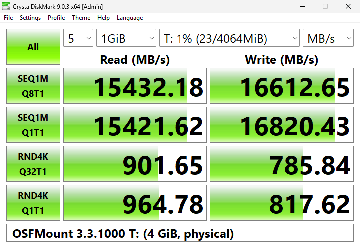</a> | 15,181 / 17,081 | 15,278 / 17,152 | 863 / 783 | 918 / 807 |
| [ImDisk Toolkit 20250206, AWE](comparison/R05-imdisk.md) | <a href="images/comparison/R05-imdisk.png">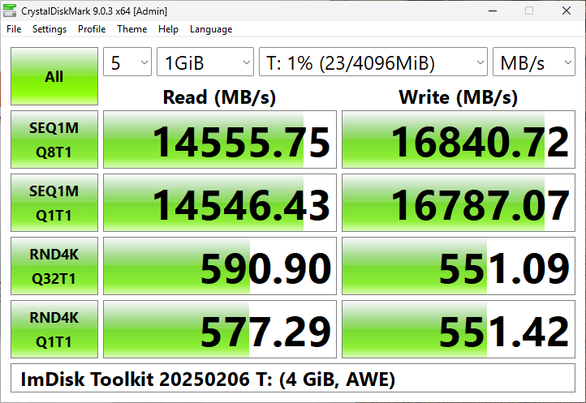</a> | 14,556 / 16,841 | 14,546 / 16,787 | 591 / 551 | 577 / 551 |
| [Primo Ramdisk 6.6.0, Direct-IO](comparison/R06-primo-directio.md) | <a href="images/comparison/R06-primo-directio.png">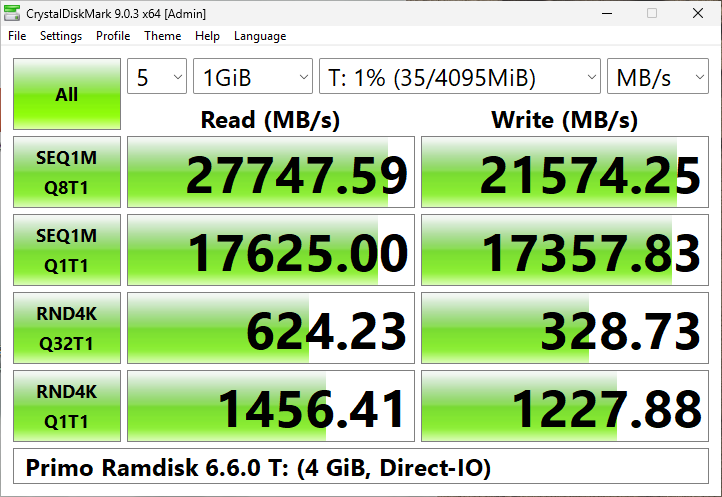</a> | 27,748 / 21,574 | 17,625 / 17,358 | 624 / 329 | 1,456 / 1,228 |
| [Primo Ramdisk 6.6.0, SCSI](comparison/R06-primo-scsi.md) | <a href="images/comparison/R06-primo-scsi.png">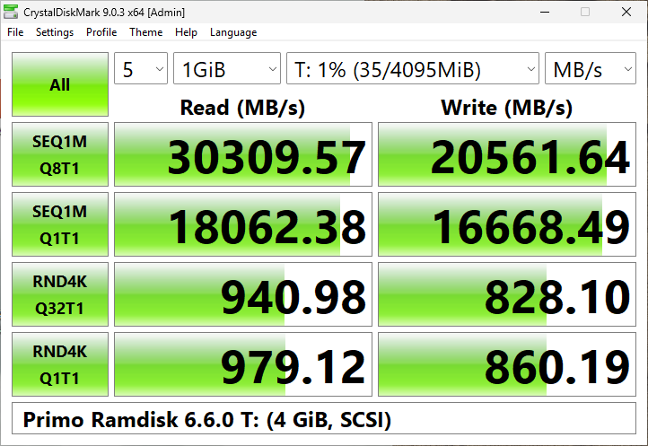</a> | 26,404 / 20,704 | 16,601 / 17,068 | 927 / 803 | 975 / 833 |
| [SoftPerfect RAM File System 26.10, default](comparison/R08-softperfect-ramfs.md) | <a href="images/comparison/R08-softperfect-ramfs.png">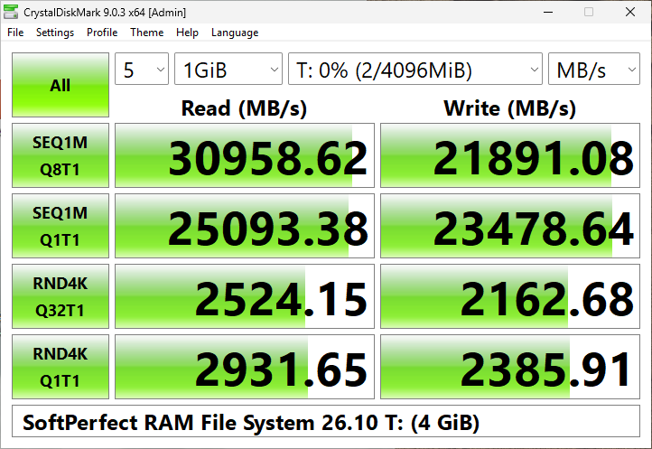</a> | 30,959 / 21,891 | 25,093 / 23,479 | 2,524 / 2,163 | 2,932 / 2,386 |
| [ManagedDrive 2.3.0, WinFsp 2.1](comparison/R10-manageddrive.md) | <a href="images/comparison/R10-manageddrive.png">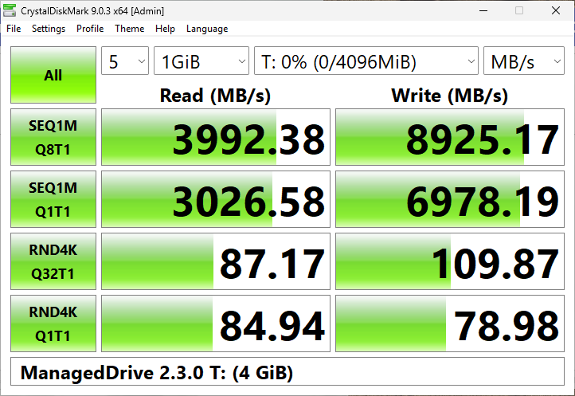</a> | 3,992 / 8,925 | 3,027 / 6,978 | 87 / 110 | 85 / 79 |

## RAM caches: CrystalDiskMark

A 2 GiB RAM cache on Q:, a 200 GB virtual SSD on network storage. The test file fits in the cache, so this shows
cached data. Writes in write-back modes are acknowledged from RAM; [the complete comparison](#ram-caches-complete-comparison)
shows what happens when they have to reach the disk.

| Product | CrystalDiskMark | SEQ1M Q8T1 read / write | SEQ1M Q1T1 read / write | RND4K Q32T1 read / write | RND4K Q1T1 read / write |
|---|---|---:|---:|---:|---:|
| [Q: without any cache Windows 11, baseline](comparison/C00-no-cache.md) | <a href="images/comparison/C00-no-cache.png">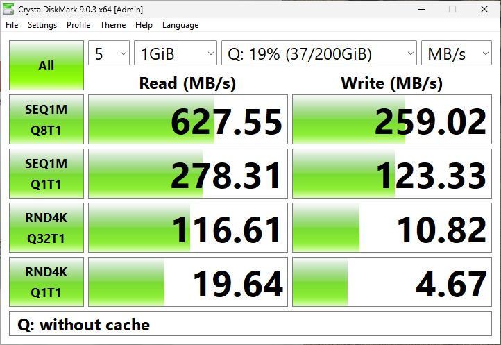</a> | 628 / 259 | 278 / 123 | 117 / 11 | 20 / 5 |
| [QueueCache 0.4.604.1, Fast, 2 GiB](comparison/C01-queuecache-fast.md) | <a href="images/comparison/C01-queuecache-fast.png">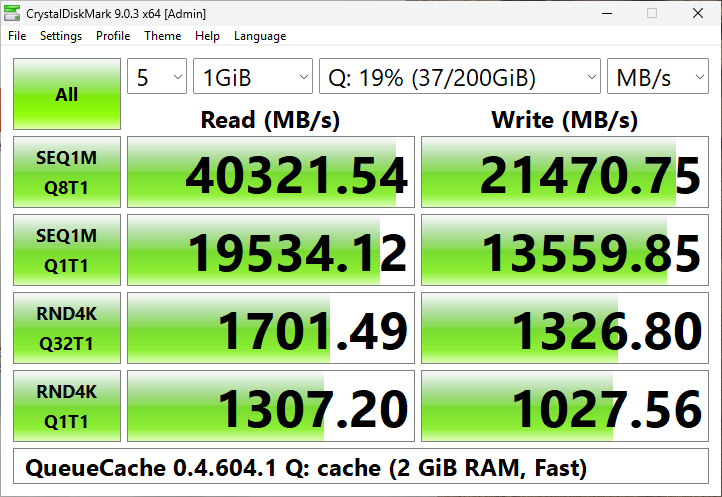</a> | 40,322 / 21,471 | 19,534 / 13,560 | 1,701 / 1,327 | 1,307 / 1,028 |
| [QueueCache 0.4.687.1, Fast, 2 GiB, 1024 KiB × 4](comparison/C01-queuecache-fast-fix687.md) | <a href="images/comparison/C01-queuecache-fast-fix687.png">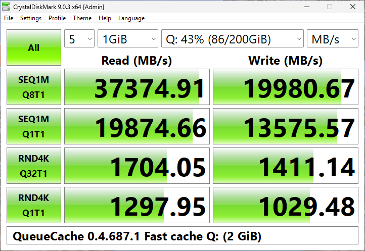</a> | 37,375 / 19,981 | 19,875 / 13,576 | 1,704 / 1,411 | 1,298 / 1,029 |
| [QueueCache 0.4.604.1, Strict, 2 GiB](comparison/C01-queuecache-strict.md) | <a href="images/comparison/C01-queuecache-strict.png">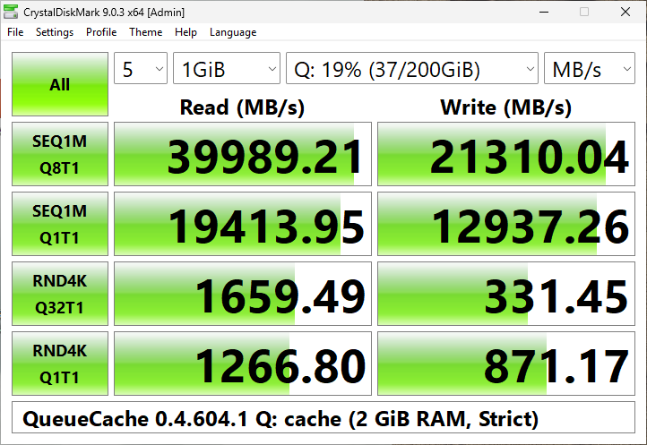</a> | 39,989 / 21,310 | 19,414 / 12,937 | 1,659 / 331 | 1,267 / 871 |
| [PrimoCache 4.4.1, L1 2 GiB, Defer-Write](comparison/C02-primocache-defer.md) | <a href="images/comparison/C02-primocache-defer.png">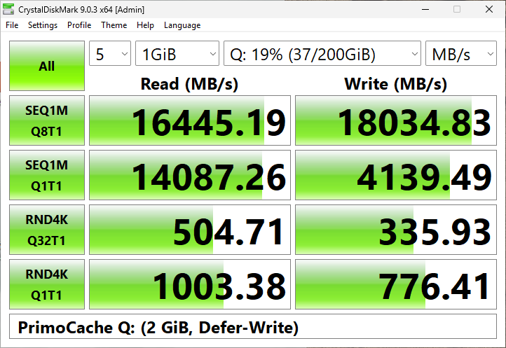</a> | 16,445 / 18,035 | 14,087 / 4,139 | 505 / 336 | 1,003 / 776 |
| [PrimoCache 4.4.1, L1 2 GiB, no Defer-Write](comparison/C02-primocache-through.md) | <a href="images/comparison/C02-primocache-through.png">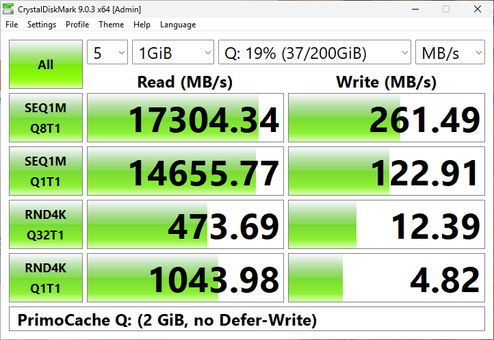</a> | 17,304 / 261 | 14,656 / 123 | 474 / 12 | 1,044 / 5 |

October 15/16 refresh with Defender/Search disabled; MB/s. Real captures;
[setup and limits](COMPARISON_DETAILS.md#current-cache-refresh-2026-10-1516).

| Mode | Real CrystalDiskMark capture | SEQ1M Q8T1 R / W | SEQ1M Q1T1 R / W | RND4K Q32T1 R / W | RND4K Q1T1 R / W |
|---|---|---:|---:|---:|---:|
| [QueueCache paused](comparison/C00-no-cache.md) | <a href="images/comparison/off-refresh-20261016.png">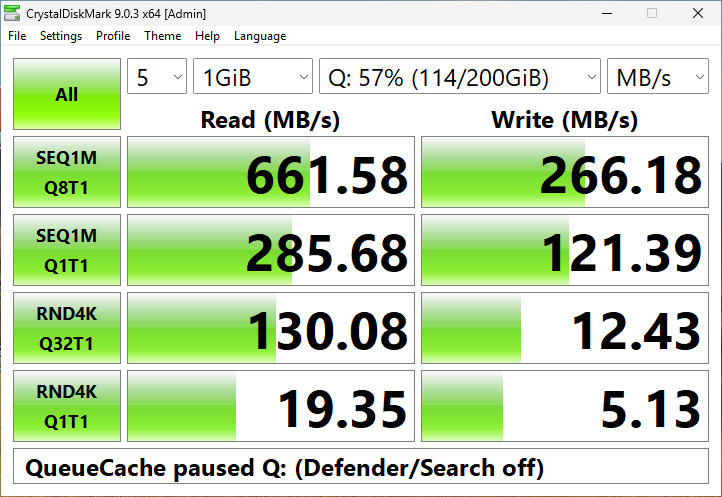</a> | 662 / 266 | 286 / 121 | 130 / 12 | 19 / 5 |
| [QueueCache Fast, 2 GiB, 1024 KiB × 4](comparison/C01-queuecache-fast-fix687.md) | <a href="images/comparison/on-refresh-20261016.png">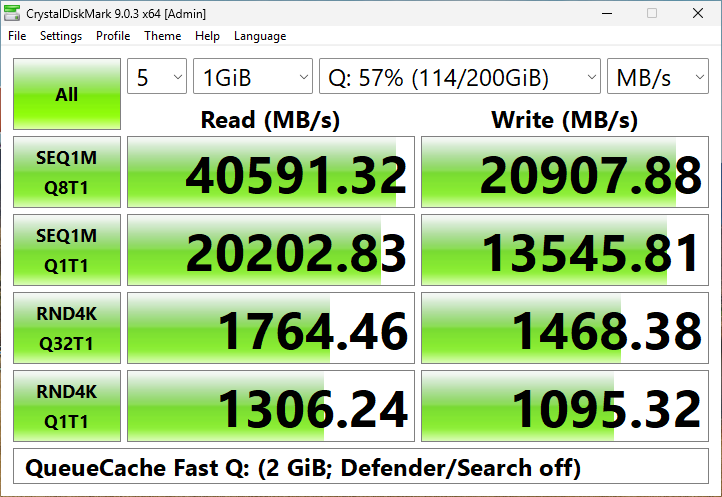</a> | 40,591 / 20,908 | 20,203 / 13,546 | 1,764 / 1,468 | 1,306 / 1,095 |
| [PrimoCache 4.4.1, L1 2 GiB, Defer-Write 10 s](comparison/C02-primocache-defer.md) | <a href="images/comparison/primo-refresh-20261016.png">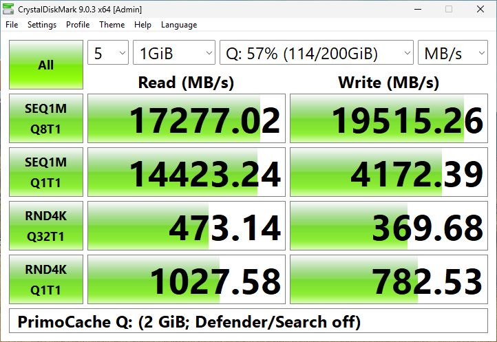</a> | 17,277 / 19,515 | 14,423 / 4,172 | 473 / 370 | 1,028 / 783 |

## RAM disks: complete comparison

Medians of three repetitions measured with DiskSpd on a 1 GiB file (ranges on each tool's page). Q is the number of
requests one program keeps in flight, T the number of programs (threads). The 4K Q1 p99 column is the latency that
99% of single 4 KiB requests stay under. CPU is the share of all four processors busy during the 1 MiB Q8 read.
RAM used is how much less memory Windows had available right after the empty 4 GiB disk was created: disks that reserve all their memory up front show about 4,096 MiB, disks that allocate memory as data arrives show little (each tool's page has memory snapshots after writing 1 GiB and 2 GiB more). The file tree is 40,000
files (1.2 GiB): create, copy with four threads, read back and check, delete.

| Product | SEQ1M Q1T1 R / W | SEQ1M Q8T1 R / W | SEQ1M Q8T4 R / W | RND4K Q1T1 R / W | RND4K Q32T1 R / W | RND4K Q32T4 R / W | 4K Q1 p99 R / W (µs) | CPU, 1M Q8 read | RAM used by the empty disk (MiB) | File tree create / copy / read / delete (s) | Price | Problems | Status |
|---|---:|---:|---:|---:|---:|---:|---:|---:|---:|---:|---|---|---|
| [QueueCache 0.4.604.1, RAM disk](comparison/R01-queuecache.md) | 25,103 / 16,743 | 45,245 / 23,625 | 25,450 / 25,876 | 1,611 / 1,234 | 1,457 / 1,157 | 5,071 / 3,844 | 6 / 10 | 93 % | 4,077 | 4.7 / 4.5 / 3.0 / 5.2 | Free (MIT) | None | Measured |
| [SoftPerfect RAM Disk 26.10, static](comparison/R02-softperfect.md) | 12,171 / 12,951 | 30,465 / 20,990 | 30,595 / 25,267 | 1,585 / 1,301 | 1,500 / 1,287 | 5,182 / 4,224 | 4 / 5 | 64 % | 4,084 | 4.5 / 4.4 / 3.0 / 4.5 | $29 per PC (30-day trial used) | None | Measured |
| [SoftPerfect RAM Disk 26.10, hard-disk emulation](comparison/R02-softperfect-hdd.md) | 14,146 / 10,747 | 35,386 / 21,317 | 29,851 / 26,003 | 1,053 / 921 | 986 / 886 | 3,482 / 3,023 | 11 / 14 | 67 % | 4,063 | 4.4 / 4.5 / 2.9 / 4.4 | $29 per PC (30-day trial used) | None | Measured |
| [AIM Toolkit 20260420, static](comparison/R03-aim-static.md) | 3,773 / 3,703 | 4,428 / 4,385 | 4,392 / 4,417 | 82 / 90 | 227 / 220 | 220 / 217 | 77 / 58 | 32 % | 1,031 | 5.1 / 5.6 / 3.0 / 5.4 | Free (AGPL) | None | Measured |
| [AIM Toolkit 20260420, dynamic (RamDyn)](comparison/R03-aim-dynamic.md) | 3,227 / 2,906 | 3,739 / 3,247 | 3,711 / 3,253 | 75 / 82 | 179 / 176 | 180 / 174 | 83 / 69 | 31 % | 4 | 5.2 / 6.1 / 3.1 / 5.5 | Free (AGPL) | None | Measured |
| [OSFMount 3.3.1000, logical emulation](comparison/R04-osfmount-logical.md) | 16,400 / 18,128 | 16,410 / 18,212 | 23,165 / 25,591 | 1,744 / 1,390 | 1,679 / 1,368 | 5,697 / 4,534 | 3 / 4 | 26 % | 4,209 | 4.5 / 4.3 / 2.9 / 4.2 | Free | None | Measured |
| [OSFMount 3.3.1000, physical emulation](comparison/R04-osfmount-physical.md) | 15,409 / 17,399 | 15,180 / 17,206 | 22,864 / 25,591 | 934 / 805 | 876 / 779 | 3,108 / 2,698 | 14 / 17 | 25 % | 4,045 | 5.1 / 4.5 / 2.9 / 4.5 | Free | None | Measured |
| [ImDisk Toolkit 20250206, AWE](comparison/R05-imdisk.md) | 14,800 / 17,102 | 14,888 / 17,108 | 20,128 / 22,247 | 584 / 537 | 548 / 516 | 982 / 989 | 20 / 21 | 25 % | 4,149 | 4.5 / 4.4 / 2.9 / 4.4 | Free | None | Measured |
| [Primo Ramdisk 6.6.0, Direct-IO](comparison/R06-primo-directio.md) | 17,967 / 17,793 | 27,548 / 20,958 | 27,211 / 25,344 | 1,480 / 1,208 | 587 / 342 | 2,882 / 2,135 | 4 / 7 | 62 % | 4,073 | 4.6 / 4.9 / 3.0 / 4.6 | $24.95-54.95 (30-day trial used) | None | Measured |
| [Primo Ramdisk 6.6.0, SCSI](comparison/R06-primo-scsi.md) | 17,031 / 17,440 | 26,656 / 20,988 | 27,135 / 24,998 | 994 / 828 | 941 / 806 | 3,392 / 2,913 | 12 / 15 | 62 % | 3,994 | 4.6 / 4.7 / 3.0 / 4.6 | $24.95-54.95 (30-day trial used) | None | Measured |
| [SoftPerfect RAM File System 26.10, default](comparison/R08-softperfect-ramfs.md) | 25,145 / 23,713 | 30,497 / 21,626 | 31,289 / 25,157 | 2,978 / 2,364 | 2,614 / 2,206 | 8,624 / 7,476 | 2 / 2 | 63 % | 0 | 1.6 / 1.2 / 2.6 / 1.8 | $29 per PC (30-day trial used) | None | Measured |
| [ManagedDrive 2.3.0, WinFsp 2.1](comparison/R10-manageddrive.md) | 2,745 / 6,812 | 3,208 / 8,830 | 2,698 / 8,654 | 84 / 75 | 86 / 110 | 93 / 122 | 80 / 90 | 34 % | 361 | 17.0 / 8.4 / 9.2 / 15.4 | Free (MIT) | None | Measured |

## RAM caches: complete comparison

The first table retains October 12–14 results with the October 16 plan-148 drain
columns. The second keeps the October 15/16 generic refresh and adds the latest
October 16/17 decision screen and October 17 gather experiment in its drain
columns. N/A means not measured for that build/session. [Methods, backing-write sizes and limits](COMPARISON_DETAILS.md#drain-decision-screen-2026-10-1617).
[Other column definitions](COMPARISON_DETAILS.md#cache-column-definitions).

| Product | Hot SEQ1M Q8T1 R / W | Hot RND4K Q1T1 R / W | First / second read of 1 GiB, cache emptied | 8 GiB file: RND4K Q32 / SEQ1M Q8 read | 1 GiB burst write | Drain after the burst: seconds / MB/s | 8 GiB sustained write: average / slowest second | Write-through 1M Q8 | Flush after 512 MiB (s) | Power loss: saved / unsaved data kept, chkdsk | 70/30 mix | File tree create / copy / read / delete (s) | Oct 16: new 1 GiB + drain MB/s (range) | Oct 16: new 4,096 × 64 KiB + drain MB/s (range) | Oct 16: mean backing write KiB, large / small | Problems | Status |
| --- | ---: | ---: | ---: | ---: | ---: | ---: | ---: | ---: | ---: | --- | ---: | ---: | ---: | ---: | ---: | --- | --- |
| [Q: without any cache Windows 11, baseline](comparison/C00-no-cache.md) | 571 / 251 | 12.1 / 4.1 | 560 / 573 | 86.2 / 668.6 | 256 | 2 / 230 | 242.5 / 218.6 | 251 | 0.001 | 100% / 100%, file system clean | 11.0 | 31.9 / 28.3 / 4.9 / 23.9 | **48.41** (42.63–53.43) | **1.25** (1.23–1.33) | 988.8 / 5.0 | None | Measured |
| [QueueCache 0.4.604.1, Fast, 2 GiB](comparison/C01-queuecache-fast.md) | 39,487 / 21,214 | 1,294.6 / 982.4 | 217 / 26,416 | 11.8 / 262.0 | 2,665 | 10 / 105 | 178.3 / 116.9 | 21,077 | 0.000 | 100% / 100%, file system needs repair (chkdsk 13) | 11.7 | 12.1 / 8.6 / 4.9 / 16.9 | N/A — not run | N/A — not run | N/A — not run | Historical: filesystem repair [#13](https://github.com/devedse/QueueCache/issues/13); serialized misses fixed [#14](https://github.com/devedse/QueueCache/issues/14); drain follow-up [#15](https://github.com/devedse/QueueCache/issues/15) | Measured |
| [QueueCache 0.4.687.1, Fast, 2 GiB, 1024 KiB × 4](comparison/C01-queuecache-fast-fix687.md) | 34,775 / 20,655 | 1,297.2 / 1,008.0 | 571 / 19,638 | 80.9 / 621.9 | 2,960 | 7 / 153 | 259.6 / 177.7 | 20,630 | 0.000 | - | 34.4 | 50.2 / 13.7 / 154.2 / 15.9 | **52.71** (42.25–62.13) | **41.71** (18.36–41.94) | 1009.6 / 341.9 | Historical tree scan overhead; no new-build power-cut repeat; drain gap [#15](https://github.com/devedse/QueueCache/issues/15) | Measured |
| [QueueCache 0.4.604.1, Strict, 2 GiB](comparison/C01-queuecache-strict.md) | 40,874 / 3,477 | 1,300.3 / 0.0 | 187 / 16,409 | 6.0 / 221.4 | 1,112 | 25 / 41 | 52.9 / 0.0 | 52 | 12.564 | 100% / 100%, file system clean | 4.1 | 212.9 / 129.8 / 4.9 / 263.8 | N/A — not run | N/A — not run | N/A — not run | Historical: six zero-completion windows; long Strict stalls [#16](https://github.com/devedse/QueueCache/issues/16); misses since fixed [#14](https://github.com/devedse/QueueCache/issues/14) | Measured |
| [PrimoCache 4.4.1, L1 2 GiB, Defer-Write](comparison/C02-primocache-defer.md) | 17,172 / 19,036 | 1,020.5 / 522.1 | 512 / 13,883 | 129.9 / 384.0 | 8,444 | 7 / 149 | 486.2 / 374.9 | 19,013 | 0.001 | 100% / 100%, file system clean | 23.7 | 21.4 / 8.4 / 4.9 / 14.9 | **78.96** (72.99–84.00) | **57.62** (50.64–65.24) | 1975.6 / 1746.2 | Historical: lost newest files; NTFS damage in later churn cuts (table below) | Measured |
| [PrimoCache 4.4.1, L1 2 GiB, no Defer-Write](comparison/C02-primocache-through.md) | 17,253 / 250 | 1,056.1 / 4.1 | 409 / 16,775 | 128.9 / 413.9 | 259 | 2 / 289 | 259.4 / 237.5 | 255 | 0.001 | 100% / 100%, file system clean | 12.7 | 28.1 / 23.1 / 4.9 / 24.2 | N/A — not run | N/A — not run | N/A — not run | None observed in these cases | Measured |

Generic columns: October 15/16, one repetition. Drain rows: October 16/17 plans
153/154 (36 cases / 73,746 hashes); separately labeled October 17 gather rows
(12 cases / 24,582 hashes). Each row has three repetitions per shape. The latter
has no contemporaneous Primo control and cannot establish parity.
Defender/Search disabled. Experimental QueueCache rows do not qualify new defaults.
[Generic refresh](COMPARISON_DETAILS.md#current-cache-refresh-2026-10-1516) ·
[Drain decision](COMPARISON_DETAILS.md#drain-decision-screen-2026-10-1617) ·
[Gather experiment, rejected policy and endpoint caveats](COMPARISON_DETAILS.md#small-file-gather-experiment-2026-10-17).

| Mode | Hot sequential read / write MB/s | 8 GiB write app / through last disk activity MB/s | Burst tail seconds | Tree read/hash seconds | Drain session shown in row: new 1 GiB + drain MB/s (range) | Drain session shown in row: new 4,096 × 64 KiB + drain MB/s (range) | Drain session shown in row: mean backing write KiB, large / small |
| --- | ---: | ---: | ---: | ---: | ---: | ---: | ---: |
| [QueueCache paused](comparison/C00-no-cache.md) | 572.8 / 250.7 | 259.5 / 257.4 | 0.66 | 2.90 | N/A — not run | N/A — not run | N/A — not run |
| [QueueCache 0.4.687.1 Fast, 2 GiB, 1024 KiB × 4](comparison/C01-queuecache-fast-fix687.md) | 35,016.8 / 20,937.2 | 267.5 / 200.1 | 6.28 | 2.84 | N/A — different build | N/A — different build | N/A — different build |
| [PrimoCache 4.4.1, L1 2 GiB, Defer-Write 10 s](COMPARISON_DETAILS.md#drain-decision-screen-2026-10-1617) | 17,215.1 / 18,757.6 | 425.1 / 279.6 | 10.92 | 2.87 | **109.68** (100.31–117.36) | **54.47** (45.71–67.54) | 1939.0 / 1339.3 |
| [Direct disk, QueueCache absent](COMPARISON_DETAILS.md#drain-decision-screen-2026-10-1617) | N/A — not run | N/A — not run | N/A — not run | N/A — not run | **47.71** (43.60–54.87) | **1.28** (1.25–1.48) | 986.9 / 5.0 |
| [QueueCache 0.4.756.1 Fast, 1024 KiB × 4, starting control](PERFORMANCE_FINDINGS.md#drain-decision-153) | N/A — not run | N/A — not run | N/A — not run | N/A — not run | **57.81** (49.43–61.94) | **20.05** (18.59–24.66) | 1009.6 / 182.0 |
| [QueueCache 0.4.756.1 Fast, 2048 KiB × 4, experimental](PERFORMANCE_FINDINGS.md#drain-decision-153) | N/A — not run | N/A — not run | N/A — not run | N/A — not run | **74.66** (65.18–101.26) | **27.07** (25.42–65.67) | 2002.3 / 180.9 |
| [QueueCache 0.4.756.1 Fast, 2048 KiB × 8, experimental](PERFORMANCE_FINDINGS.md#drain-decision-153) | N/A — not run | N/A — not run | N/A — not run | N/A — not run | **84.24** (73.98–127.51) | **36.14** (34.15–49.95) | 2009.4 / 190.2 |
| [QueueCache 0.4.756.1 Fast, 1024 KiB × 4, ending control](PERFORMANCE_FINDINGS.md#drain-decision-153) | N/A — not run | N/A — not run | N/A — not run | N/A — not run | **66.54** (59.86–73.39) | **42.54** (29.28–51.28) | 1015.4 / 207.0 |
| [Oct 17 gather session: QueueCache 0.4.761.1, 2048 KiB × 4, current gather](COMPARISON_DETAILS.md#small-file-gather-experiment-2026-10-17) | N/A — not run | N/A — not run | N/A — not run | N/A — not run | **227.95** (227.65–261.66) | **111.85** (110.17–113.50) | 1964.4 / 1641.5 |
| [Oct 17 gather session: same build/settings, aligned gather, rejected](COMPARISON_DETAILS.md#small-file-gather-experiment-2026-10-17) | N/A — not run | N/A — not run | N/A — not run | N/A — not run | **219.98** (214.26–257.45) | **93.58** (92.16–110.98) | 1942.7 / 990.0 |

## Power cut while the cache is writing

Historical churn results: QueueCache 0.4.604.1 and PrimoCache 4.4.1; not repeated
on the final build. Damage includes zero, partial or foreign contents. A dash
means unavailable, not zero. A clean filesystem scan does not imply intact files.
[Method and interpretation](COMPARISON_DETAILS.md#power-cut-while-the-cache-is-writing);
[desired safety behavior and acceptance checks (#13)](https://github.com/devedse/QueueCache/issues/13).

| Product | Cut | Power cut | `chkdsk /scan` | Files 20-30 s old: missing / damaged | 10-20 s old: missing / damaged | Newest 10 s: intact / damaged / missing | Damaged files holding another file's data | Deleted files back (intact / damaged) |
|---|---|---|---|---:|---:|---:|---:|---:|
| Q: without a cache task (PrimoCache driver idle) | 1 | about 2 s after the churn ended | clean | 0 / 0 | 0 / 0 | 1833 / 41 / 0 | 0 | 0 / 0 |
| Q: without any cache | 2 | during the write-out, 20 s after the churn | clean | 0 / 0 | 0 / 0 | 1830 / 0 / 0 | not classified | 0 / 0 |
| QueueCache 0.4.604.1 Fast 2 GiB | 1 | about 2 s after the churn ended | clean | 0 / 0 | 0 / 0 | 1568 / 265 / 42 | 0 | 11 / 0 |
| QueueCache 0.4.604.1 Fast 2 GiB | 2 | about 2 s after the churn ended | clean | 0 / 0 | 0 / 0 | 1567 / 266 / 41 | 0 | 11 / 0 |
| QueueCache 0.4.604.1 Fast 2 GiB | 3 | during the write-out, 5 s after the churn | clean | 0 / 0 | 0 / 0 | 1875 / 0 / 0 | not classified | 0 / 0 |
| QueueCache 0.4.604.1 Fast 2 GiB | 4 | during the write-out, 10 s after the churn | clean | 0 / 0 | 0 / 0 | 1875 / 0 / 0 | not classified | 0 / 0 |
| PrimoCache 4.4.1 Defer-Write 2 GiB | 1 | about 2 s after the churn ended | clean | 0 / 0 | 0 / 316 | 0 / 44 / 1831 | not classified | 304 / 65 |
| PrimoCache 4.4.1 Defer-Write 2 GiB | 2 | about 2 s after the churn ended | clean | 0 / 0 | 0 / 49 | 286 / 232 / 1356 | not classified | 265 / 36 |
| PrimoCache 4.4.1 Defer-Write 2 GiB | 3 | about 2 s after the churn ended | ⚠ not run: the check stopped, NTFS reported a file "corrupted and unreadable" | - | - | - | - | - |
| PrimoCache 4.4.1 Defer-Write 2 GiB | 4 | about 2 s after the churn ended | ⚠ needs offline repair (exit 13), 26 files unreadable | 369 / 50 | 1751 / 0 | 0 / 0 / 1875 | 152 | 275 / 320 |
| PrimoCache 4.4.1 Defer-Write 2 GiB | 5 | about 2 s after the churn ended | clean | 0 / 0 | 0 / 189 | 446 / 309 / 1120 | 144 | 221 / 47 |
| PrimoCache 4.4.1 Defer-Write 2 GiB | 6 | about 2 s after the churn ended | clean | 0 / 0 | 0 / 92 | 530 / 232 / 1113 | 88 | 235 / 31 |
| PrimoCache 4.4.1 Defer-Write 2 GiB | 7 | during the write-out, 11 s after the churn | clean | 0 / 0 | 0 / 0 | 1875 / 0 / 0 | not classified | 0 / 0 |

## Results per tool

Each product links to its own page: both CrystalDiskMark runs, every DiskSpd shape with latency percentiles and CPU,
the timed steps, memory snapshots and the drivers that were loaded.

- [QueueCache 0.4.604.1, RAM disk](comparison/R01-queuecache.md): Measured
- [SoftPerfect RAM Disk 26.10, static](comparison/R02-softperfect.md): Measured
- [SoftPerfect RAM Disk 26.10, hard-disk emulation](comparison/R02-softperfect-hdd.md): Measured
- [AIM Toolkit 20260420, static](comparison/R03-aim-static.md): Measured
- [AIM Toolkit 20260420, dynamic (RamDyn)](comparison/R03-aim-dynamic.md): Measured
- [OSFMount 3.3.1000, logical emulation](comparison/R04-osfmount-logical.md): Measured
- [OSFMount 3.3.1000, physical emulation](comparison/R04-osfmount-physical.md): Measured
- [ImDisk Toolkit 20250206, AWE](comparison/R05-imdisk.md): Measured
- [Primo Ramdisk 6.6.0, Direct-IO](comparison/R06-primo-directio.md): Measured
- [Primo Ramdisk 6.6.0, SCSI](comparison/R06-primo-scsi.md): Measured
- [SoftPerfect RAM File System 26.10, default](comparison/R08-softperfect-ramfs.md): Measured
- [ManagedDrive 2.3.0, WinFsp 2.1](comparison/R10-manageddrive.md): Measured
- [Q: without any cache Windows 11, baseline](comparison/C00-no-cache.md): Measured
- [QueueCache 0.4.604.1, Fast, 2 GiB](comparison/C01-queuecache-fast.md): Measured
- [QueueCache 0.4.687.1, Fast, 2 GiB, 1024 KiB × 4](comparison/C01-queuecache-fast-fix687.md): Measured
- [QueueCache 0.4.604.1, Strict, 2 GiB](comparison/C01-queuecache-strict.md): Measured
- [PrimoCache 4.4.1, L1 2 GiB, Defer-Write](comparison/C02-primocache-defer.md): Measured
- [PrimoCache 4.4.1, L1 2 GiB, no Defer-Write](comparison/C02-primocache-through.md): Measured

## Not tested

| Product | Kind | Why not |
|---|---|---|
| GiliSoft RAMDisk 7.2.0 | RAM disk | Installed and tried: the trial limits disks to 512 MB, too small for the 1 GiB tests on a 4 GiB disk. A licence costs $39.95. |
| RamDrive 0.4.7 (WinFsp) | RAM file system | Installed and tried: it is built for newer processor instructions than this VM's virtual CPU offers ("The required instruction sets are not supported by the current CPU"), so its service stops at start. It would likely run on the physical machine. |
| StarWind RAM Disk | RAM disk | Download requires a registration form; can be added if the owner downloads it. |
| Condusiv DymaxIO | RAM read cache | Trial requires an account, and its EULA (s.5.2(vii)) forbids publishing benchmark results without consent. |
| Arsenal Image Mounter (RAM disk) | RAM disk | Same Storport driver as AIM Toolkit, which is tested. |
| Ultra RAMDisk Lite | RAM disk | The vendor site serves a self-signed certificate; no trustworthy download. |
| AMD Radeon RAMDisk / Dataram RAMDisk | RAM disk | Discontinued; no vendor download any more. |
| WinRamTech (QSoft) Ramdisk Enterprise | RAM disk | Development ended in 2017; the free evaluation is limited to 256 MB, too small for the 1 GiB test. |
| ERAM | RAM disk | Unsigned 2010-era driver; needs driver signature enforcement turned off, a boot setting we do not change. |
| Dimmdrive | RAM disk | Abandoned in 2016; sold only through Steam. |
| Gavotte RamDisk | RAM disk | 32-bit, unsigned driver. |
| SuperSpeed RamDisk Plus | RAM disk | Vendor gone; no legitimate download. |
| VSuite Ramdisk | RAM disk | Old name of Primo Ramdisk, which is tested. |
| Windows built-in RAM disk | RAM disk | Windows 11 has none for users. |
| MaxVeloSSD | RAM/SSD cache | No vendor download any more. |
| Samsung RAPID (Magician) | RAM cache | Needs a Samsung SATA SSD; the VM's disk is virtual. |
| Crucial Momentum Cache | RAM write cache | Needs a supported Crucial boot SSD; caches writes only. |
| ASUS RAMCache II/III | RAM cache | Checks for an ASUS motherboard. |
| AMD StoreMI 2.x | SSD cache | No RAM cache since version 1.x ended in 2020; needs an AMD chipset. |
| eBoostr | RAM cache | Sales ended in 2022; the vendor warns its RAM cache freezes or crashes Windows 10/11. |
| VeloSSD / VeloRAM | RAM/SSD cache | Vendor domain parked; no trustworthy installer. |
| SuperCache (SuperSpeed) | RAM cache | 2013-era driver; vendor gone. |
| FancyCache | RAM cache | Old name of PrimoCache, which is tested. |
| O&O CleverCache | File-cache tuner | Discontinued; tunes the Windows file cache rather than caching blocks. |
| Condusiv V-locity | RAM read cache | Business sibling of DymaxIO with the same engine. |
| Intel RST / Optane Memory | Optane cache | Uses Optane hardware, not RAM; end of life. |
| Windows ReadyBoost | Flash cache | Uses USB flash, not RAM. |
| SSD-tier caches (PrimoCache L2, FuzeDrive and others) | SSD cache | Not RAM caches. |

## How this was measured

| | |
|---|---|
| Host | AMD Ryzen 9 9955HX (16 cores), 96 GB DDR5-5600, Proxmox VE 9.2 |
| Virtual machine | Windows 11 (26H1, build 28000), 4 vCPUs, 16 GB RAM, no Driver Verifier, Memory Integrity off |
| Q: | 200 GB virtual SSD on Ceph network storage |
| Tools | CrystalDiskMark 9.0.3 and its DiskSpd 2.2 for every product; QueueCache's `qcache developer verify` comparison suites (plan 121), which use no QueueCache feature |

Original rows used Defender enabled with folder exclusions; October 15/16
refreshes disabled Defender/Search. Different dates and workloads are descriptive
comparisons, not isolated speedups.
[Full setup and qualifications](COMPARISON_DETAILS.md#how-this-was-measured).
